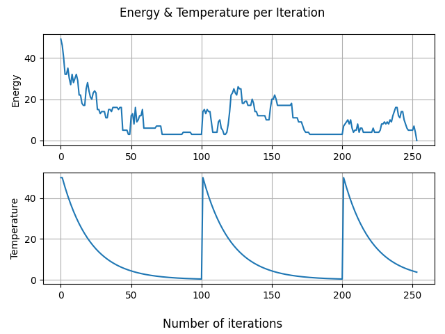

# Sudoku Solver with Simulated Annealing

## Overview

A learning project exploring the use of **simulated annealing and the Metropolis–Hastings algorithm** to solve Sudoku puzzles. The current implementation focuses on testing different state transitions and temperatures, with basic visualization of convergence.

## How It Works

1. Generate a valid Sudoku board and remove cells to create a puzzle.
2. Fill empty cells randomly while ensuring each row contains the numbers 1–9 exactly once.
3. Calculate an "energy" based on violations of basic Sudoku row, column, and box constraints.
4. Use `change_t4` to propose new configurations by swapping values within rows.
5. Accept or reject changes using the Metropolis criterion, gradually lowering the temperature until a solution is found or the iteration limit is reached.

## Example Convergence

The following plot shows how the energy and temperature evolve
during a simulated annealing run.



## Main Functions

- `set_given_board(n_givens)` — Generates a randomized Sudoku puzzle.
- `smart_fill(state)` — Fills empty cells while preserving row constraints.
- `count_instances_rcb(board, coord)` and `check_error(state, coord)` — Evaluate Sudoku constraint violations.
- `energy(state)` — Calculates the total number of erroneous cells; zero indicates a solution.
- `change_t1`–`change_t4(state)` — Different approaches to exploring the configuration space. `change_t4` is the primary method, introducing occasional random swaps to help escape local minima.
- `choose_metropolis(E_0, E_1, T)` — Probabilistically accepts new configurations based on their energy difference and temperature.
- `exp_T(...)` and other temperature functions — Define alternative cooling schedules.
- `plot_E_T(...)` — Plots energy and temperature throughout the simulation.

## Running the Script

**Requirements:** Python 3., NumPy, and Matplotlib.

```bash
pip install numpy matplotlib
python sudoku.py
```

Parameters such as the maximum iterations (`t_max`), initial temperature (`T_max`), and number of givens (`n_givens`) can be adjusted near the bottom of the script.

## Future Improvements

- Create a `SudokuBoard` class supporting custom puzzles and a solver method.
- Implement conventional methods, such as backtracking, for comparison in time and memory usage.
- Compare convergence rates and runtimes across different transition methods and cooling processes.
- Add board visualization and animations during the search (for fun).

## Project Status

An experimental project for exploring probabilistic optimization. It is intended for learning and experimentation rather than as general-purpose Sudoku solving.